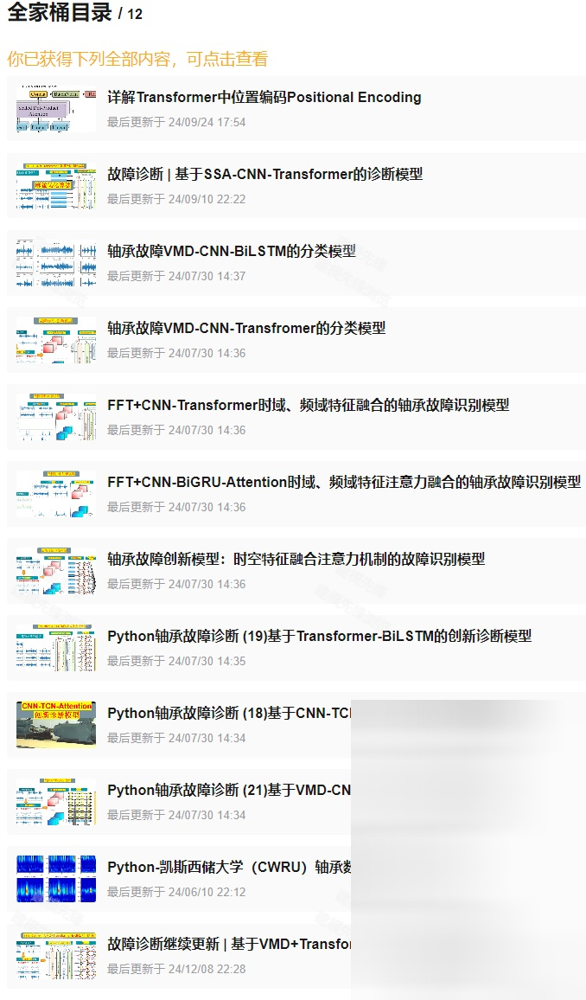

# Fault Diagnosis Model Based on VMD+WDCNN-SENet

\tPreface  
\tThis article is based on the bearing data from Case Western Reserve University (CWRU), which first undergoes data preprocessing to create and load the dataset, and finally implements the VMD-WDCNN-SENet model for fault classification through Pytorch. For a detailed introduction to the CWRU bearing data, refer to the following:  
\t  
Python-Case Western Reserve University (CWRU) Bearing Data Interpretation and Classification Processing  
\t  
\tFull set of links:  
1 Model Introduction and Innovation Points Introduction  
\t1.1 Model Introduction  
● Dataset: CWRU Case Western Reserve University Bearing Dataset  
● Environmental framework: Python 3.9, Pytorch 1.8 or above are required to run  
● Accuracy: 100% on the test set  
● Usage: Paper requirements, graduation design requirements  
● Code guarantee: Code with detailed comments can be run successfully.  
\t1.2 Innovation Points Introduction  
\tBearing Fault Diagnosis Innovative Model Based on VMD+WDCNN-SENet:  
\t1. Innovation Points:  
\t (1)\t Utilizing VMD to decompose the original signal into multiple mode components, to extract signal frequency domain and time domain features, improving signal separability, providing clearer signal input for subsequent feature extraction and classification;  
\t (2)\t Introducing WDCNN structure to realize wide convolution feature extraction, enhancing global feature expression: WDCNN uses large convolution kernels (e.g., kernel=64, stride=16) to extract long-term window features, thus obtaining global temporal structural patterns. Subsequent layers use small convolution kernels to extract local change features.
(3) Integration of SENet channel attention mechanism to achieve adaptive enhancement in feature selection. Embed a SENet (Squeeze-and-Excitation Network) module after each convolutional module, calculate the global average response (Squeeze) for each channel and adaptively learn channel weights (Excitation). The SENet automatically enhances channels with high contributions, suppresses redundant channels; focuses on the frequency band and mode that best represent fault characteristics.
2. Principle and Process:
Firstly, the raw bearing signal is decomposed using VMD to obtain multiple modal components; each modal component serves as input and undergoes feature extraction through the \tWDCNN-SENet network. Within this network, WDCNN captures the long-term dependency features of the signal through the first layer wide convolutional layers, achieving global temporal pattern extraction. In subsequent layers of narrow convolutional and pooling operations, the network further mines local detail features, thus balancing both global and local feature representation capabilities. SENet adaptively learns the importance weights of each channel through a "global average pooling—channel recalibration" approach, thereby strengthening the feature channels related to faults and suppressing redundant or noisy channels, achieving precise focus on critical information. After extracting features for all IMF modal components, the model fuses the deep feature vectors of each modality (Feature Fusion) to construct an integrated feature representation that encompasses multi-frequency bands and multi-scale information. Finally, these fused features are fed into a Softmax classifier to automatically identify and classify different types of bearing faults.
2. Bearing Data Loading and Preprocessing
2.1 Import Data
Refer to the previous article for preprocessing of fault classification 10, and the Case Western Reserve University bearing data set: Classification 10 dataset.
1. Training set, validation set, and test set are all divided into 7:2:1 according to the drawings for training, validation, and testing, respectively, and data is finally saved.
2.2 Fault VMD decomposition visualization
2.3 Preprocessing of fault data VMD decomposition
3 Innovative Diagnosis Model Based on VMD+WDCNN-SENet
3.1 Define the VMD+WDCNN-SENet network model
3.2 Set parameters and train the model
50 epochs, accuracy 100%, VMD+WDCNN-SENet network classification effect is significant, WDCNN-SENet model can fully extract multi-scale features of bearing fault signals, converges quickly, and has particularly excellent performance, with noticeable effects.
3.3 Model evaluation
(1) Accuracy, precision, recall, F1 Score
(2) Fault very class confusion matrix:
(3) Classification label visualization
(4) Original data t-SNE feature visualization
(5) T-SNE feature visualization after model training:
Click to download: Complete original data, Python code
Previously interesting content:
Python Bearing Fault Diagnosis | From Beginner to Publication
Python Bearing Fault Diagnosis (14) High Innovation Fault Identification Model
SCI 1st Class High Innovation Bearing Fault Diagnosis Model!
Attention Magic Modification | Superstrong Bearing Fault Diagnosis Model!
Bearing Fault Diagnosis Model Based on K-NN + GCN
27 Bearing Fault Diagnosis Models | The most cost-effective family kit available online
Based on KAN, KAN convolutional bearing fault diagnosis model
Time-frequency graph update | Bearing Fault Diagnosis Based on Visual Top Conference + Time-frequency graph
Fault Diagnosis | Code explanation + live courses, hotly ongoing!
Fast Paper | Parallel Fault Diagnosis Model Based on 2D-SWinTransformer + 1D-CNN-SENet
Positional Encoding Demystified | A Comprehensive Guide to Transformer's Positional Encoding
Resource Sharing | Intelligent Fault Diagnosis and Prediction Based on Graph Neural Networks
Innovation Point | Fast Fourier Transform Convolution (FFC)-Based Fault Diagnosis Model
Code Open Source! | Fault Diagnosis in Varying Conditions with Domain Adversarial Convolutional Networks
Over Thirty Open-Source Datasets | No More Worries About Datasets for Fault Diagnosis!
Fault Diagnosis | An essential tool for postgraduate and second-year students in research papers!!!
Superior! Top Conference Innovation Integration! Parallel Classification Network Based on 2D-SWinTransformer
Multimodal - Fault Diagnosis | The Big Core Convolution Opens a New Era of Vision!
Transformer Structure Advantage, How Much Attention Do You Need?
Fault Diagnosis | A Small Innovation: Feature Extraction + KAN Classification
Superior! Directly write in the first region! Based on SSA+Informer-SENet Fault Diagnosis Model
Fault Diagnosis | Collection of Signal Noise Reduction Algorithms
New additions to graph convolution fault diagnosis, including GAT, SGCN, GIN classification models
Bearing Life Prediction Full Kit Coming!
Cannot Miss! Major Updates in Fault Diagnosis + Time-Frequency Image Classification!
Recommended Journals for Intelligent Fault Diagnosis and Life Prediction
Direct writing in the first region for Fault Diagnosis + Graph Convolution + BiGRU-Attention Parallel Diagnosis Model
END

## Images

<!-- PAYMENT_BLOCK -->

## Get this dataset

- Payment link (Stripe): [Buy now](https://buy.stripe.com/3cs8yP7sY87d0vu9AB)
- Payment QR code: 

<!-- /PAYMENT_BLOCK -->
